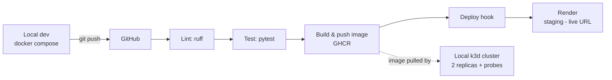
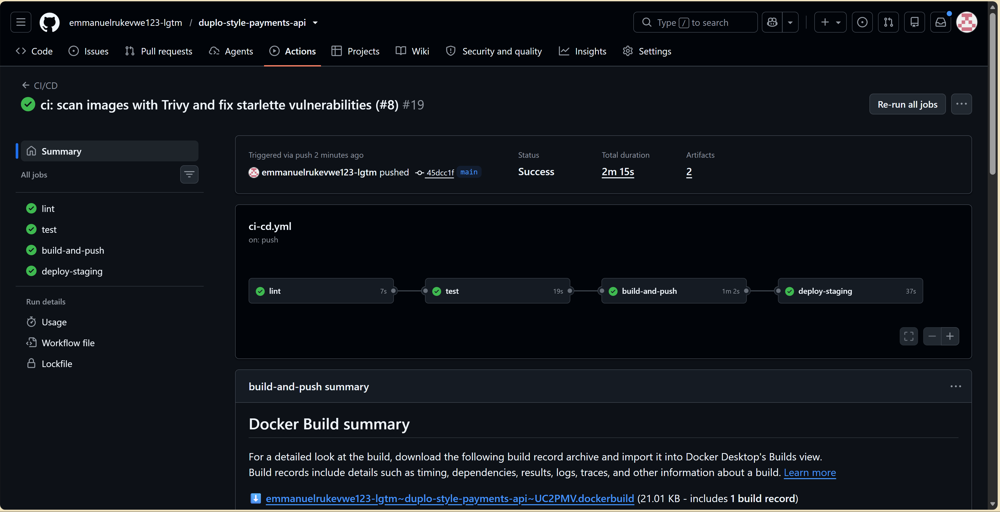
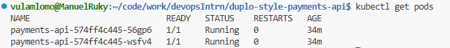

# Duplo-style Payments API


A mock **B2B invoice/payments REST API** built as a DevOps portfolio project: FastAPI service,
containerised with Docker, shipped through a GitHub Actions CI/CD pipeline to GitHub Container
Registry and a [Render](https://render.com) deploy hook, with Kubernetes manifests for a local
k3d cluster.

**Live demo:** not deployed yet; run it locally with Docker Compose (below).
**API docs:** `/docs` (Swagger UI)

## Architecture



## Endpoints

| Method | Path | Description |
|---|---|---|
| POST | `/invoices` | Create a pending invoice |
| GET | `/invoices` / `/invoices/{id}` | List / fetch invoices (404 if unknown) |
| POST | `/invoices/{id}/pay` | Pay an invoice (409 if already paid) |
| GET | `/transactions` | List payment transactions |
| GET | `/health` | Health check: status, version, env |
| GET | `/metrics` | Prometheus metrics incl. `invoices_paid_total` |

Data lives in an in-memory store isolated behind `app/store.py`, so it can be swapped for
Postgres without touching route handlers.

## Configuration & environments

All config comes from environment variables (never hardcoded):

| Variable | Purpose | dev | staging (Render) | k8s |
|---|---|---|---|---|
| `APP_ENV` | Environment name reported by `/health` | `.env` | Render dashboard | ConfigMap |
| `LOG_LEVEL` | Logging verbosity | `.env` | Render dashboard | ConfigMap |
| `APP_VERSION` | Version reported by `/health` | `.env` | Render dashboard | Secret (demo) |
| `RENDER_DEPLOY_HOOK` | Pipeline → Render trigger | — | GitHub Environment `staging` secret | — |

`.env.example` documents every variable; copy it to `.env` for local use (`.env` is gitignored).

## Run locally

```bash
cp .env.example .env
docker compose up --build
curl localhost:8000/health
```

Or without Docker:

```bash
python3 -m venv .venv && .venv/bin/pip install -r requirements-dev.txt
.venv/bin/uvicorn app.main:app --reload
```

Tests and lint:

```bash
.venv/bin/ruff check . && .venv/bin/pytest
```

## CI/CD pipeline

On every PR: **ruff → pytest**. On push to `main`, additionally:
**build image → push to `ghcr.io/emmanuelrukevwe123-lgtm/duplo-style-payments-api` (`latest` + git SHA) → curl the Render deploy hook** (stored as a secret in the GitHub Environment `staging`).

## Kubernetes (local k3d)

```bash
k3d cluster create payments
kubectl create secret generic payments-api-secrets --from-literal=APP_VERSION=k3d-manual
kubectl apply -f k8s/
kubectl get pods                                  # expect 2/2 Running
kubectl port-forward svc/payments-api 8080:80
curl localhost:8080/health
```

The Deployment runs 2 replicas as non-root with resource limits and liveness/readiness probes on
`/health` — delete a pod and watch Kubernetes replace it.

<!-- Screenshots: add after first green pipeline + k3d deploy


-->

## Related projects

- [payments-monitoring-lab](https://github.com/emmanuelrukevwe123-lgtm/payments-monitoring-lab) — Prometheus/Grafana/Alertmanager stack monitoring this API, with runbooks and a post-mortem.
- [ops-toolkit](https://github.com/emmanuelrukevwe123-lgtm/ops-toolkit) — automation scripts (health checks with Telegram alerts, backups, Docker cleanup) servicing this deployment.

## License

[MIT](./LICENSE) © 2026 Emmanuel Nwabuokei
