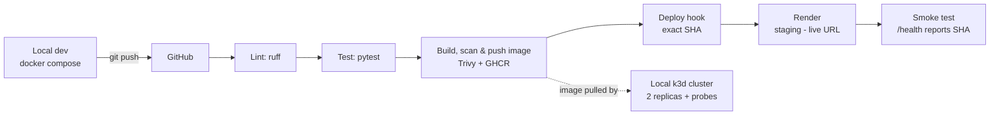

# Duplo-style Payments API


A mock **B2B invoice/payments REST API** built as a DevOps portfolio project: FastAPI service,
containerised with Docker, shipped through a GitHub Actions CI/CD pipeline to GitHub Container
Registry and a live [Render](https://render.com) deployment, with Kubernetes manifests for a local
k3d cluster.

**Live demo:** [dashboard](https://duplo-style-payments-api-latest.onrender.com/app/) · [health](https://duplo-style-payments-api-latest.onrender.com/health) (free tier: the first request after idling can take about a minute)
**API docs:** `/docs` (Swagger UI)

## Architecture



## Endpoints

| Method | Path | Description |
|---|---|---|
| POST | `/invoices` | Create a pending invoice |
| GET | `/invoices` / `/invoices/{id}` | List / fetch invoices (404 if unknown) |
| POST | `/invoices/{id}/pay` | Pay an invoice (409 if already paid) |
| GET | `/transactions` | List payment transactions |
| GET | `/health` | Health check: status, version, env |
| GET | `/metrics` | Prometheus metrics incl. `invoices_paid_total` |

Data lives in an in-memory store isolated behind `app/store.py`, so it can be swapped for
Postgres without touching route handlers.

## Configuration & environments

All config comes from environment variables (never hardcoded):

| Variable | Purpose | dev | staging (Render) | k8s |
|---|---|---|---|---|
| `APP_ENV` | Environment name reported by `/health` | `.env` | Render dashboard | ConfigMap |
| `LOG_LEVEL` | Logging verbosity | `.env` | Render dashboard | ConfigMap |
| `APP_VERSION` | Version reported by `/health` | `.env` | Built into image (git SHA) | Secret (demo) |
| `RENDER_DEPLOY_HOOK` | Pipeline → Render trigger | — | GitHub Environment `staging` secret | — |
| `RENDER_URL` | Service URL checked by the smoke test | — | GitHub Environment `staging` variable | — |

`.env.example` documents every variable; copy it to `.env` for local use (`.env` is gitignored).

## Run locally

```bash
cp .env.example .env
docker compose up --build
curl localhost:8000/health
```

The Ledgerly payments dashboard is available at `http://localhost:8000/app/`. It uses the
invoice, payment, transaction, and health endpoints directly; API reference remains available
at `http://localhost:8000/docs`.

Or without Docker:

```bash
python3 -m venv .venv && .venv/bin/pip install -r requirements-dev.txt
.venv/bin/uvicorn app.main:app --reload
```

Tests and lint:

```bash
.venv/bin/ruff check . && .venv/bin/pytest
```

## CI/CD pipeline

On every PR: **ruff → pytest**. On push to `main`, additionally:
**build image → scan with Trivy → push to `ghcr.io/emmanuelrukevwe123-lgtm/duplo-style-payments-api` (`latest` + git SHA) → curl the Render deploy hook with that exact SHA image → smoke test `/health` until it reports the new SHA** (the hook is stored as a secret in the GitHub Environment `staging`).

## Kubernetes (local k3d)

```bash
k3d cluster create payments --api-port 6550
kubectl create secret generic payments-api-secrets --from-literal=APP_VERSION=k3d-manual
kubectl apply -f k8s/
kubectl get pods                                  # expect 2/2 Running
kubectl port-forward svc/payments-api 8080:80
curl localhost:8080/health
```

The Deployment runs 2 replicas as non-root with resource limits and startup, liveness and readiness
probes on `/health`. Delete a pod and watch Kubernetes replace it.

The Secret is created by hand because it must not live in Git. `examples/secret.example.yaml` shows
its shape, and sits outside `k8s/` so `kubectl apply -f k8s/` cannot overwrite the real value.

`--api-port` fixes the API port. Without it, k3d picks a random one, which fails on Windows if that
port is in a reserved range (`ports are not available`).

## Screenshots


## Known limitations

- **Data is not persistent.** Invoices live in each process's memory, so they are lost on restart or
  redeploy.
- **Replicas do not share data.** With 2 replicas, an invoice created on one pod returns `404` from the
  other, and could be paid twice. The fix is a shared database behind `app/store.py`, which would make
  the pods stateless.
- **No authentication.** Anyone with the URL can create and pay invoices, which is acceptable only for
  mock data.
- **Money uses `float`.** A real payments system should use a decimal type.
- **The image scan ignores unfixed vulnerabilities.** Trivy fails the build on fixable HIGH and CRITICAL
  findings only; findings with no available fix are not blocked.
- **The k3d Deployment is pinned by hand.** Its SHA tag is updated manually, not by the pipeline.
- **Free tier cold starts.** The Render service sleeps when idle, so the first request can be slow.

## Related projects

- [payments-monitoring-lab](https://github.com/emmanuelrukevwe123-lgtm/payments-monitoring-lab) — Prometheus/Grafana/Alertmanager stack monitoring this API, with runbooks and a post-mortem.
- [ops-toolkit](https://github.com/emmanuelrukevwe123-lgtm/ops-toolkit) — automation scripts (health checks with Telegram alerts, backups, Docker cleanup) servicing this deployment.

## License

[MIT](./LICENSE) © 2026 Emmanuel Nwabuokei
